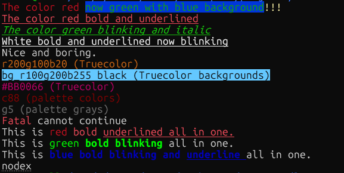

# lua-nxterm

**lua-nxterm** is a feature-rich, pure-Lua drop-in replacement for [ansicolors](https://github.com/kikito/ansicolors.lua). On top of that you get 256-color and truecolor, fluent chaining, cursor and screen control, and modern terminal features (hyperlinks, titles, progress, synchronized output).

```lua
local colors = require('nxterm')              -- was: require('ansicolors')
print(colors('%{bright red}Error:%{reset} something went wrong'))
print(colors.noReset('%{green}no resets around this'))
```

[](LICENSE)
[](https://www.lua.org/)
[](https://no-color.org/)

```lua
local nxterm = require('nxterm')
local sc = nxterm.color

print(sc.red.bold('Error:') .. ' something went wrong')
print(sc'red bold ul' .. 'styled text')
print(nxterm.escape_codes('Status: %{green bold}OK%{}'))
```

---

## Intent

`nxterm` is a small, dependency-free toolkit for talking to terminals the way modern CLI tools expect:

- **Colors & styles** via SGR (standard 16 colors, bright, 256-color palette, truecolor RGB/hex, underline colors)
- **Cursor & screen control** (move, save/restore, hide, erase, scroll regions)
- **Modern OSC/CSI extras** (hyperlinks, window title, cwd, progress, synchronized output, focus, mouse)
- **Ergonomic APIs** — fluent chaining, classic key strings, and `%{...}` embedding in format strings

It is designed to be **easy to drop into existing projects**, including as a drop-in replacement for ansicolors (see [Migrating from ansicolors](#migrating-from-ansicolors)).

No ncurses. No C bindings. Just escape sequences that work on xterm-compatible terminals (Linux console, macOS Terminal, iTerm2, Windows Terminal, Kitty, Ghostty, WezTerm, Alacritty, tmux, …).

---

## Features

| Area | Capabilities |
|------|----------------|
| **Styles** | bold, dim, italic, underline (single/double/wavy/dot/dash), blink, inverse, strike, superscript/subscript |
| **Colors** | 16 ANSI + bright, 256-color (`c88`), greyscale (`g0`–`g23`), truecolor (`r100g50b0`, `#rrggbb`, `#rgb`) |
| **Underline color** | `ul_c`, `ul_g`, `ul_r`, `ul_#` where supported |
| **Fluent API** | `sc.red.bold.ul` emits **one** combined SGR sequence |
| **Classic API** | `sc('red bold')`, `sc'red bold ul'`, `sc['green italic']` |
| **Embedding** | `%{red bold}text%{}` via `escape_codes` / `format` / `printf` |
| **Cursor** | move, absolute/relative position, SCO + DEC save/restore, hide/show, style (DECSCUSR) |
| **Screen** | erase, line insert/delete, scroll up/down, **scroll region** |
| **Modes** | alt screen, bracketed paste, sync output (`?2026`), focus (`?1004`), wrap (`?7`) |
| **Mouse** | normal tracking + SGR reporting |
| **OSC** | title, hyperlinks (OSC 8), cwd (OSC 7), progress bar (OSC 9;4), bell |
| **Environment** | respects [`NO_COLOR`](https://no-color.org/); runtime `nxterm.strip = true` |

---

## Installation

With [LuaRocks](https://luarocks.org/):

```sh
luarocks install lua-nxterm
```

From source:

```sh
git clone https://github.com/SamOrlando/lua-nxterm.git
cd lua-nxterm
luarocks make rockspecs/lua-nxterm-0.3.1-1.rockspec
```

Or vendor the single file `nxterm.lua` next to your script:

```text
your-app/
  nxterm.lua
  main.lua
```

```lua
local nxterm = require('nxterm')
```

Pure Lua 5.1 – 5.4 and LuaJIT, no dependencies. Optional: Unix `stty` for fast terminal size detection and `tty.raw()` / `tty.sane()`.



Runnable examples live in [`examples/`](examples/) (`lua examples/basic.lua`, `lua examples/showcase.lua` for an animated truecolor demo). Every public function is documented in [`docs/reference.md`](docs/reference.md).

---

## Quick start

```lua
local nxterm = require('nxterm')
local sc = nxterm.color   -- or nxterm.colour

-- Fluent chaining (single SGR sequence)
print(sc.red.bold('Fatal') .. ' cannot continue')

-- Classic key string
print(sc('green bold') .. 'done' .. sc'')

-- Embedded codes (always starts and ends with reset)
print(nxterm.escape_codes('Build %{cyan}%{bold}passed%{} in 1.2s'))

-- Cursor + clear
io.write(nxterm.cursor.hide())
io.write(nxterm.erase())           -- clear screen
io.write(nxterm.cursor.setlc(1, 1))
io.write(nxterm.cursor.show())
```

---

## Colors & styles

### Three equivalent styles

```lua
local sc = nxterm.color

-- 1) Fluent / chained properties
print(sc.red.bold.ul .. 'hello' .. sc.reset)

-- 2) Call with key list
print(sc('red bold ul') .. 'hello' .. sc'')
print(sc'red bold ul' .. 'hello')           -- sugar

-- 3) Embedded in a string
print(nxterm.escape_codes('%{red bold ul}hello%{}'))
```

Fluent chains accumulate parameters and emit **one** sequence:

```text
sc.red.bold  →  ESC[31;1m     (not ESC[31mESC[1m)
```

Calling a fluent chain with text auto-resets afterward:

```lua
print(sc.red.bold('hello'))   -- ESC[31;1mhelloESC[0m
```

### Color keys

| Kind | Examples |
|------|----------|
| Foreground | `black` `red` `green` `yellow` `blue` `magenta` `cyan` `white` `default` |
| Bright fg | `red_b` `green_b` … `grey` / `gray` |
| Background | `bg_red` `bg_blue` … `bg_default` |
| Bright bg | `bg_red_b` … `bg_grey` |
| 256-color | `c88` `bg_c88` `ul_c88` |
| Greyscale | `g0`…`g23` `bg_g10` `ul_g10` |
| Truecolor | `r200g100b20` `bg_r100g200b255` `ul_r0g0b0` |
| Hex | `#BB0066` `#f0c` `bg_#003366` `ul_#ff0` |

Unknown or out-of-range keys (`c256`, `g24`, `#12345`, `r300g0b0`) are ignored rather than raising errors (ansicolors raises `Unknown key` instead; this is the one behavioural difference).

ansicolors aliases are accepted everywhere: `hidden`, `blackbg` … `whitebg` (kikito) and `clear`, `underscore`, `onblack` … `onwhite` (hoelzro).

### Style keys

`bold` / `b`, `dim`, `italic` / `i`, `underline` / `ul` / `under`,  
`ul_single` `ul_double` `ul_wavy` `ul_dot` `ul_dash`,  
`blink`, `inverse` / `reverse`, `strike`, `hide`,  
`sup` / `super`, `sub`, and matching `*_off` / `reset` / `rf` / `normal`.

### Embedding & formatting

```lua
local es = nxterm.escape_codes

-- Each result is wrapped with reset so styles do not leak
print(es('[%{red}ERROR%{}] %{bold}disk full'))

-- empty %{} is also a reset
print(es('%{green}ok%{} continuing'))

-- format / printf process %{} then call string.format
nxterm.printf('Task %{cyan}%s%{} → %{green bold}%s', 'build', 'done')
```

`escape_strip(...)` removes `%{...}` markers without emitting codes (useful for plain-text logs).

---

## Migrating from ansicolors

### kikito/ansicolors.lua (LuaRocks `ansicolors`)

The `nxterm` module itself is a drop-in replacement for [ansicolors.lua](https://github.com/kikito/ansicolors.lua) 1.0.2:

```lua
-- Before
local colors = require('ansicolors')
-- After
local colors = require('nxterm')

print(colors('%{red}hello'))                 -- ESC[0m ESC[31m hello ESC[0m
print(colors('%{bright blue redbg}x%{reset} y'))
print(colors.noReset('%{green}no reset around this'))
```

- `colors(...)` is `nxterm.escape_codes(...)`: markup expanded and wrapped in resets; non-strings go through `tostring` (`nil` / `false` → `''`).
- `colors.noReset(str)` expands markup only (strings and numbers).
- All ansicolors keys work: `reset bright dim underline blink reverse hidden`, the 8 colours and `blackbg` … `whitebg`; `%{bright_red}` = `bright` + `red`.
- Every nxterm key works inside the markup too (`%{bg_c88}`, `%{#ff8800}`, `%{italic}`), and `NO_COLOR` / `nxterm.strip` turn all codes off.

`tests/test_ansicolors_compat.lua` compares 1,167 cases with the real module. The output renders identically; the bytes can differ because:

- nxterm merges keys into one sequence (`ESC[1;31m` instead of `ESC[1mESC[31m`);
- an empty `%{}` expands to `ESC[m` (a reset) instead of nothing.

Differences in behaviour:

- **Unknown keys are ignored**, not raised as `Unknown key: <word>` (the one documented difference).
- An unterminated `%{` stays literal text; in ansicolors it swallows the trailing reset.
- ansicolors turns codes off on Windows unless `ANSICON` is set; nxterm uses `NO_COLOR` / `nxterm.strip`.

To keep the old module name, add a one-line `ansicolors.lua` to your project:

```lua
return require('nxterm')
```

### hoelzro/ansicolors (superseded by lua-term)

[hoelzro/ansicolors](https://github.com/hoelzro/ansicolors) uses property access; `nxterm.color` supports the same forms and all of its key names (`clear`, `underscore`, `hidden`, `onred` …):

```lua
local colors = require('nxterm').color         -- was: require('ansicolors')

print(colors.red .. 'hello' .. colors.reset)
print(colors.red('hello'))                    -- auto-reset after text
print(colors.red, 'hello', colors.reset)
print(colors.onblue .. colors.underscore .. 'x' .. colors.clear)

-- nxterm extras
print(colors.red.bold.ul('hello'))            -- single combined sequence
print(colors('red bold underline') .. 'hi')
print(colors['bg_blue white bold'] .. 'banner' .. colors.reset)
```

---

## Cursor

```lua
local c = nxterm.cursor

io.write(c.hide())
io.write(c.setlc(1, 1))          -- row 1, col 1 (standard order)
io.write(c.set(10, 5))           -- col 10, row 5
io.write(c.up(2) .. c.forward(4))
io.write(c.save())               -- SCO save
-- ...
io.write(c.restore())
io.write(c.dec_save())           -- DEC ESC 7 (often more reliable)
io.write(c.dec_restore())        -- DEC ESC 8
io.write(c.style(2))             -- DECSCUSR: 0 block, 1/2 block, 3/4 underline, 5/6 bar
io.write(c.show())
```

Aliases: `c.right` / `c.left` / `c.next_line` / `c.prev_line`.

`c.get()` queries position via DSR (`CSI 6n`) and returns `{col, row}`, or `nil` on failure.  
**Note:** this read can block if stdin is not a live TTY; prefer `nxterm.size()` for dimensions.

---

## Screen, lines, scroll

```lua
io.write(nxterm.erase())              -- clear screen (CSI 2J)
io.write(nxterm.erase(0))             -- clear below cursor
io.write(nxterm.line.erase())         -- clear line
io.write(nxterm.line.insert(2))
io.write(nxterm.scroll.up(3))
io.write(nxterm.scroll.region(2, 20)) -- set scrolling region
io.write(nxterm.scroll.region())      -- reset region (full screen)
```

`nxterm.clear` is an alias of `nxterm.erase`.

---

## Modes & mouse

```lua
io.write(nxterm.mode.alt_screen(true))       -- alternate buffer
io.write(nxterm.mode.bracketed_paste(true))
io.write(nxterm.mode.sync(true))             -- synchronized update (tear-free)
io.write(nxterm.mode.focus(true))            -- focus in/out events
io.write(nxterm.mode.wrap(false))            -- disable line wrap

io.write(nxterm.mouse.on())                  -- ?1000 + ?1006
-- ...
io.write(nxterm.mouse.off())

io.write(nxterm.mode.alt_screen(false))
```

Generic setters:

```lua
nxterm.mode.set(7, true)    -- CSI ?7h
nxterm.mode.reset(7, true)  -- CSI ?7l
nxterm.mode.set({1049, 2004}, true)  -- several modes at once: CSI ?1049;2004h
```

Legacy helpers: `nxterm.mode.ansi()` (VT52 → ANSI mode, `ESC <`) and `nxterm.mode.gpu(on)` (DEC special-graphics line-drawing charset on/off, `ESC ( 0` / `ESC ( B`).

---

## OSC helpers

```lua
io.write(nxterm.title('my app'))
io.write(nxterm.cwd('/home/user/project'))
io.write(nxterm.bell())

-- Hyperlink (OSC 8); stripped to plain text when nxterm.strip is set
print(nxterm.link('https://example.com', 'example.com'))

-- Taskbar / tab progress (OSC 9;4)
-- state: 0=hide, 1=normal, 2=error, 3=indeterminate, 4=paused
io.write(nxterm.progress(1, 42))   -- 42%
io.write(nxterm.progress(3))       -- indeterminate
io.write(nxterm.progress(0))       -- hide
```

---

## Terminal size

```lua
local sz = nxterm.size()   -- {width, height} or nil
if sz then
  print(('cols=%d rows=%d'):format(sz[1], sz[2]))
end
```

Uses `stty size` when available, then falls back to a cursor probe.  
`nxterm.mode.size` is an alias.

---

## NO_COLOR & strip

```lua
-- Automatic: strip defaults to true when NO_COLOR is set in the environment
-- Manual:
nxterm.strip = true   -- all SGR / link sequences become empty / plain text
nxterm.strip = false
```

When stripped:

- `sc.red` → `''`
- `nxterm.link(url, text)` → `text`
- `%{red}` → empty substitution

---

## API map

```text
nxterm
├── color / colour / sgr()     fluent + classic SGR
├── nxterm(...) / noReset       ansicolors drop-in (module call = escape_codes)
├── escape_codes / escape_strip
├── format / writef / printf / print
├── title, link, cwd, progress, bell
├── reset, erase / clear
├── line.{erase, insert, delete}
├── scroll.{up, down, region}
├── shift.{left, right}
├── char.{insert, delete, erase, rep}
├── tab, backtab
├── mode.{set, reset, alt_screen, bracketed_paste, sync, focus, wrap, ansi, gpu, size}
├── mouse.{on, off}
├── tty.{sane, raw}
├── cursor.{up, down, forward, back, nl, pl, set, setlc, setx, sety,
│          save, restore, dec_save, dec_restore, hide, show, style, get, getlc}
└── size()
```

---

## Practical examples

### Status line

```lua
local sc = nxterm.color
local function status(ok, msg)
  local tag = ok and sc.green.bold('[ OK ]') or sc.red.bold('[FAIL]')
  print(tag .. ' ' .. msg)
end

status(true,  'compiled 12 packages')
status(false, 'missing dependency: libfoo')
```

### Progress with title

```lua
io.write(nxterm.title('installing…'))
for i = 0, 100, 10 do
  io.write(nxterm.progress(1, i))
  io.write(('\r%{cyan}Installing%%%{reset} %3d%%'):format(i)
    :gsub('%%{(.-)}', function(k)
      return require('nxterm').color(k)
    end))
  io.flush()
  -- sleep…
end
io.write(nxterm.progress(0))
io.write(nxterm.title('done'))
print()
```

### Alternate screen UI frame

```lua
local c = nxterm.cursor
io.write(nxterm.mode.alt_screen(true))
io.write(nxterm.mode.sync(true))
io.write(c.hide())
io.write(nxterm.erase())
io.write(c.setlc(1, 1) .. nxterm.color.bg_blue.white.bold(' My TUI ') .. nxterm.color'')
-- draw…
io.write(nxterm.mode.sync(false))
io.write(c.show())
io.write(nxterm.mode.alt_screen(false))
```

### ansicolors-compatible module shim

```lua
-- ansicolors.lua
return require('nxterm')
```

---

## Design notes

- **Single SGR emission** on fluent chains — fewer bytes, cleaner logs, better for multiplexers.
- **`escape_codes` always brackets** output with reset so accidental style leaks are rare.
- **Empty key list** (`sc''`, `%{}`) emits `ESC[m` (full attribute reset).
- **No dependencies** — sequences only; you decide when to write them.
- **MIT license** — use it anywhere.

---

## Limitations

- `cursor.get()` may **block** if the terminal does not answer DSR; use `size()` for geometry when possible.
- Truecolor, underline styles, OSC 8/9;4, and sync mode depend on terminal support (degrade safely on older emulators).
- Windows: works under Windows Terminal / ConPTY with VT processing enabled; `stty`-based size needs a Unix-like environment or the cursor fallback.

---

## Tests

```sh
lua tests/test.lua                      # any of lua5.1 … lua5.4, luajit
lua tests/test_ansicolors_compat.lua    # comparison with ansicolors (luarocks install ansicolors)
luarocks test                           # via the rockspec
```

---

## Changes

### 0.3.1

- The module is the ansicolors drop-in: `require('nxterm')` is callable (same as `escape_codes`) and has `noReset`. The separate `nxterm.ansicolors` table from 0.3.0 is removed.
- `escape_codes` converts non-string arguments with `tostring` (`nil` / `false` → `''`) instead of skipping them.
- `%{bright_red}`-style keys (parts joined by `_`) expand to each part when every part is a key.
- Unknown keys are ignored everywhere (0.3.0's `nxterm.ansicolors` raised).

### 0.3.0

- `nxterm.ansicolors`: drop-in replacement for kikito/ansicolors.lua (call form, `noReset`, strict keys, byte-identical output).
- Key aliases from both ansicolors libraries: `hidden`, `blackbg` … `whitebg`, `clear`, `underscore`, `onblack` … `onwhite`.

### 0.2.0

- First public release.

---

## License

MIT — Copyright (c) 2024–2026 Sam Orlando. See [LICENSE](LICENSE).

---

## See also

- [ANSI escape code](https://en.wikipedia.org/wiki/ANSI_escape_code)
- [XTerm control sequences](https://invisible-island.net/xterm/ctlseqs/ctlseqs.html)
- [NO_COLOR](https://no-color.org/)
- [ansicolors.lua](https://github.com/kikito/ansicolors.lua) and [hoelzro/ansicolors](https://github.com/hoelzro/ansicolors) (API inspiration for the `%{...}` markup and the simple color surface)
